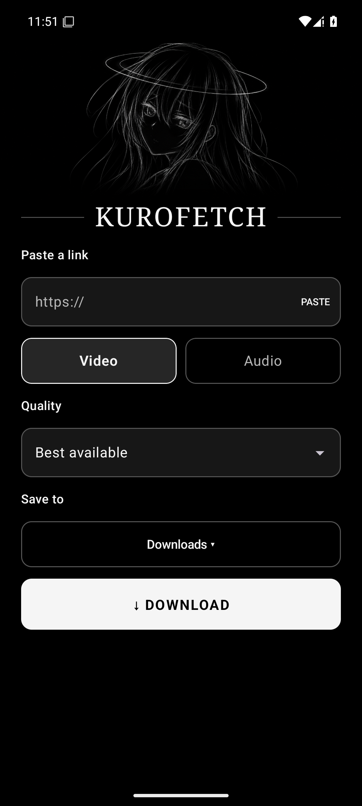

# KuroFetch

**Download what matters.**

[Leia em português](README.md)

A minimal black-and-white Android app for downloading media. Processing takes place on your device using yt-dlp and FFmpeg.



## Features

- Share links from Android apps or paste a URL.
- Download video or MP3 audio, with quality options.
- Save to Downloads or choose another folder.
- Track background downloads through a notification.
- The interface follows the device language, with English and Portuguese available.

Available formats depend on the source and content. Downloads are started one at a time. Spotify links are not specifically supported. Only download content when you have permission to do so and follow the source platform’s terms.

## Compatibility

- Android 10 or later.
- The app includes yt-dlp, a Python runtime, QuickJS and FFmpeg through the components described in [THIRD_PARTY_NOTICES.md](THIRD_PARTY_NOTICES.md).
- External services may change and require updates. Not all sites or links have been tested.

## Build

Open the project in Android Studio or use JDK 17 or later and Android SDK 35:

```bash
./gradlew assembleDebug testDebugUnitTest
```

On Windows, replace `./gradlew` with `gradlew.bat`. The debug APK is created at `app/build/outputs/apk/debug/`. It is signed with the build machine’s debug key and is not intended as a production release.

## License

KuroFetch is available under the [GNU General Public License version 3](LICENSE). Dependencies and bundled components have their own notices and licenses; see [THIRD_PARTY_NOTICES.md](THIRD_PARTY_NOTICES.md).
