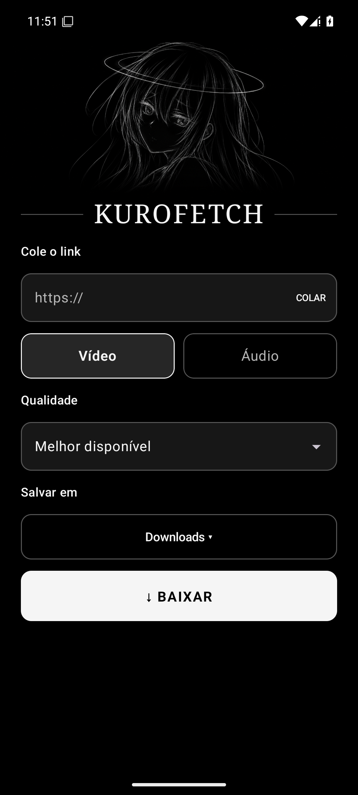

# KuroFetch

**Baixe o que importa.**

[Read in English](README.en.md)

Um aplicativo Android para baixar mídia, com uma interface minimalista em preto e branco. O processamento acontece no próprio dispositivo usando yt-dlp e FFmpeg.



## Recursos

- Receba links pelo menu Compartilhar do Android ou cole um endereço no aplicativo.
- Escolha entre vídeo e áudio em MP3, com opções de qualidade.
- Salve em Downloads ou escolha outra pasta.
- Acompanhe o download em segundo plano por uma notificação.

A disponibilidade dos formatos depende da fonte e do conteúdo. Cada download é iniciado individualmente. Links do Spotify não são suportados especificamente. Use o aplicativo apenas quando tiver autorização para baixar o conteúdo e respeite os termos da plataforma de origem.

## Compatibilidade

- Android 10 ou superior, com interface em português ou inglês conforme o idioma do dispositivo.
- O aplicativo inclui yt-dlp, um runtime Python, QuickJS e FFmpeg através dos componentes indicados em [THIRD_PARTY_NOTICES.md](THIRD_PARTY_NOTICES.md).
- Serviços externos podem mudar e exigir atualizações. Nem todos os sites e links foram testados.

## Compilar

Abra o projeto no Android Studio ou use a linha de comando com JDK 17 ou superior e Android SDK 35:

```bash
./gradlew assembleDebug testDebugUnitTest
```

No Windows, substitua `./gradlew` por `gradlew.bat`. O APK de depuração será criado em `app/build/outputs/apk/debug/`. Ele é assinado com a chave de depuração da máquina usada na compilação e não deve ser usado como versão de produção.

## Licença

O código do KuroFetch é disponibilizado sob a [GNU GPL versão 3](LICENSE). As dependências e os componentes incorporados têm seus próprios avisos e licenças; consulte [THIRD_PARTY_NOTICES.md](THIRD_PARTY_NOTICES.md).
